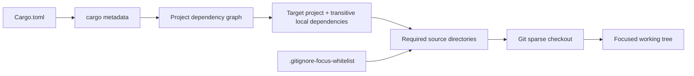

# git-focus

`git-focus` reduces a large Git repository to the source needed for one project and its transitive local dependencies. It uses Git sparse checkout, keeps repository history intact, and does not delete ignored build caches.

The executable is also a Git extension: `git-focus ...` and `git focus ...` are equivalent when it is on `PATH`.

## Install from GitHub

Requires Node.js 20+.

```text
npm install -g git+https://github.com/iXab3r/git-focus.git
git-focus install-skill
```

Verify the installation:

```text
git-focus --help
```

The first command adds the CLI to `PATH`. The second copies the bundled Agent Skill to `$HOME/.agents/skills/git-focus`; rerun it whenever the skill needs to be refreshed.

To install from an existing local clone instead:

```text
npm install -g .
git-focus install-skill
```

## What it does



`git-focus` separates dependency discovery from Git mutation. The language adapter produces a project graph; the planner selects the dependency closure; the Git service converts the selected source directories into sparse-checkout scopes.

Before changing sparse checkout, it verifies that every planned repository is clean. Staged, modified, or untracked files stop the operation unless the user explicitly passes `--force`.

Ignored files such as Cargo `target/` directories remain in place. `git-focus` does not fetch, pull, clean, stash, commit, or update submodule revisions.

## Quick start

Preview the scope for a Rust project:

```text
git-focus plan path/to/Cargo.toml --repo path/to/repository
```

Apply it:

```text
git-focus path/to/Cargo.toml --repo path/to/repository
```

Inspect or restore the repository:

```text
git-focus status --repo path/to/repository
git-focus full --repo path/to/repository
```

Use `--without-dev` to exclude development-only dependency edges. Use `--force` only when intentionally overriding the clean-working-tree safety gate.

## Whitelist (preserve list)

The repository-root `.gitignore-focus-whitelist` file contains paths that must remain visible in addition to the selected project dependency closure. It uses normal `.gitignore` syntax: blank lines, comments, anchored paths, directory patterns, globs, escaped leading characters, and `!` negation are supported.

The file is read fresh for every plan and whitelist command. You can edit it directly or use:

```text
git-focus whitelist show --repo path/to/repository
git-focus whitelist add "/docs/" --repo path/to/repository
git-focus whitelist remove "/docs/" --repo path/to/repository
git-focus whitelist match docs/guide.md --repo path/to/repository
```

`add` and `remove` operate on exact lines and retain comments and direct edits. `match` prints `WHITELISTED` or `NOT WHITELISTED`; it exits with status `0` for a match and `1` for no match.

Git cone-mode sparse checkout works at directory scope. When a pattern matches a tracked file, git-focus preserves its containing directory, including sibling files. Ignored and untracked matches already remain on disk because sparse checkout does not own them. The initial Rust policy is:

```gitignore
# Keep Rust build output available while the repository is focused.
/target/
```

The public command and filename use “whitelist” because matching paths are added to the visible set. Conceptually, it is a preserve/include list, not a blacklist: nothing matching it is excluded.
## Supported languages

| Language | Project input | Dependency source | Status |
| --- | --- | --- | --- |
| Rust | `Cargo.toml` | `cargo metadata` | Supported |

Rust is currently the only supported language. The Cargo adapter includes runtime, build, and development path dependencies, target source paths, workspace `.cargo` configuration, and physical source directories behind local links.

## How to add a language

Each language or build ecosystem is implemented as a project-input adapter. Git planning and sparse-checkout mutation remain language-independent.

1. Create `src/inputs/<language>/<language>-resolver.ts`.
2. Implement `ProjectInputResolver` from `src/inputs/types.ts`:
   - Give the resolver a unique `kind`, such as `cargo` or `msbuild`.
   - Implement `canResolve(request)` for automatic input detection.
   - Implement `resolve(request)` and return a `ProjectGraph` containing a root project and all locally addressable project nodes.
   - For each `ProjectNode`, include its manifest, every source/configuration directory required to build it, and dependency edges classified as `runtime`, `build`, or `development`.
   - Preserve both lexical and physical source paths when links or junctions are involved.
3. Register the resolver in `createServices()` in `src/cli.ts`.
4. Add resolver tests covering:
   - automatic and explicit `--type` selection;
   - transitive dependency closure;
   - development-dependency filtering;
   - source paths outside the manifest directory;
   - links or junctions;
   - actionable tool and metadata failures.
5. Add the language to the support table above and update the Agent Skill if its operating instructions change.

The adapter must only describe projects and dependencies. It must not run sparse-checkout commands or mutate Git state.

## Development

```text
npm install
npm run typecheck
npm test
npm run bundle
node dist/cli.js plan /path/to/Cargo.toml
```

`dist/` is committed so installs directly from Git do not need a package lifecycle build. Rebuild it whenever `src/` changes. Keep the developer script named `bundle`: npm treats a `build` script as a Git-dependency build trigger.
