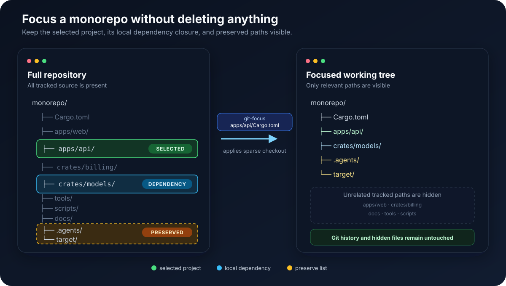
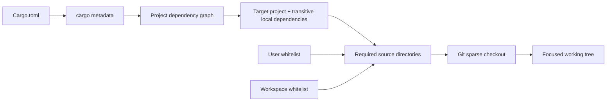

# git-focus

Large monorepos slow AI coding tools down: searches surface unrelated projects, and agents spend limited context understanding surrounding code instead of the task at hand. `git-focus` narrows the visible working tree to one project and its transitive local dependencies, making tools faster and reducing wasted context.

It uses Git sparse checkout, keeps repository history intact, and does not delete ignored build caches.

The executable is also a Git extension: `git-focus ...` and `git focus ...` are equivalent when it is on `PATH`.



Green marks the selected project, blue marks source pulled in through local dependencies, and gold marks AI context and cache paths retained by `.gitignore-focus-whitelist`. Faded paths are hidden from the working tree, not deleted; switching back to full mode makes them visible again.

## Install from GitHub

Requires Node.js 20+.

```text
npm install -g git+https://github.com/iXab3r/git-focus.git
git-focus install-skill
```

Verify the installation:

```text
git-focus --help
```

The first command installs the CLI together with its shipped user whitelist. The second copies the bundled Agent Skill to `$HOME/.agents/skills/git-focus`; it does not create configuration files in the user profile.

To install from an existing local clone instead:

```text
npm install -g .
git-focus install-skill
```

## What it does



`git-focus` separates dependency discovery from Git mutation. The language adapter produces a project graph; the planner selects the dependency closure; the Git service converts the selected source directories into sparse-checkout scopes.

Before changing sparse checkout, it verifies that every planned repository is clean. Staged, modified, or untracked files stop the operation unless the user explicitly passes `--force`.

Ignored files such as Cargo `target/` directories remain in place. `git-focus` does not fetch, pull, clean, stash, commit, or update submodule revisions.

## Quick start

Preview the scope for a Rust project:

```text
git-focus plan path/to/Cargo.toml --repo path/to/repository
```

Apply it:

```text
git-focus path/to/Cargo.toml --repo path/to/repository
```

Inspect or restore the repository:

```text
git-focus status --repo path/to/repository
git-focus full --repo path/to/repository
```

Use `--without-dev` to exclude development-only dependency edges. Use `--force` only when intentionally overriding the clean-working-tree safety gate.

## Whitelist (preserve list)

`git-focus` merges two `.gitignore`-format preserve lists for every plan:

1. The user whitelist ships as `.gitignore-focus-whitelist` inside the installed `git-focus` package and applies to every repository.
2. The optional workspace whitelist at `<repository>/.gitignore-focus-whitelist` applies only to that repository. It loads after the user whitelist, so workspace `!` rules can override user defaults.

Both files are read fresh for every plan and whitelist command. Blank lines, comments, anchored paths, directory patterns, globs, escaped leading characters, and `!` negation are supported.

Inspect the effective merged policy or one file:

```text
git-focus whitelist show --repo path/to/repository
git-focus whitelist show --scope user --repo path/to/repository
git-focus whitelist show --scope workspace --repo path/to/repository
```

Edit the workspace whitelist by default, or edit the shipped user whitelist directly with `--scope user`:

```text
git-focus whitelist add "/shared/" --repo path/to/repository
git-focus whitelist remove "/shared/" --repo path/to/repository
git-focus whitelist add "/personal-tools/" --scope user --repo path/to/repository
git-focus whitelist match shared/file.txt --repo path/to/repository
```

`add` and `remove` operate on exact lines and retain comments and direct edits. A workspace edit creates or changes a repository file, so commit it before focusing unless `--force` is explicitly intended. `match` always uses the effective merged policy; it exits with status `0` for a match and `1` for no match.

The shipped user whitelist contains:

```gitignore
# Keep Rust build output available while repositories are focused.
/target/

# Keep repository-level AI instructions, skills, and configuration visible.
/.agents/
/.claude/
/.codex/
/.continue/
/.cursor/
/.gemini/
/.github/
/.windsurf/
```

Git cone mode already keeps files at the repository root visible, including `AGENTS.md`, `CLAUDE.md`, `GEMINI.md`, `README.md`, `CONTRIBUTING.md`, `SECURITY.md`, and `LICENSE`. Broad `/docs/`, `/tools/`, and `/scripts/` directories are intentionally excluded by default because they can describe unrelated or obsolete subsystems.

When a pattern matches a tracked file, cone-mode sparse checkout preserves its containing directory, including sibling files. Ignored and untracked matches already remain on disk because sparse checkout does not own them. The public command and filename retain “whitelist”; conceptually, both files are preserve/include lists.

## Supported languages

| Language | Project input | Dependency source | Status |
| --- | --- | --- | --- |
| Rust | `Cargo.toml` | `cargo metadata` | Supported |

Rust is currently the only supported language. The Cargo adapter includes runtime, build, and development path dependencies, target source paths, workspace `.cargo` configuration, and physical source directories behind local links.

## How to add a language

Each language or build ecosystem is implemented as a project-input adapter. Git planning and sparse-checkout mutation remain language-independent.

1. Create `src/inputs/<language>/<language>-resolver.ts`.
2. Implement `ProjectInputResolver` from `src/inputs/types.ts`:
   - Give the resolver a unique `kind`, such as `cargo` or `msbuild`.
   - Implement `canResolve(request)` for automatic input detection.
   - Implement `resolve(request)` and return a `ProjectGraph` containing a root project and all locally addressable project nodes.
   - For each `ProjectNode`, include its manifest, every source/configuration directory required to build it, and dependency edges classified as `runtime`, `build`, or `development`.
   - Preserve both lexical and physical source paths when links or junctions are involved.
3. Register the resolver in `createServices()` in `src/cli.ts`.
4. Add resolver tests covering:
   - automatic and explicit `--type` selection;
   - transitive dependency closure;
   - development-dependency filtering;
   - source paths outside the manifest directory;
   - links or junctions;
   - actionable tool and metadata failures.
5. Add the language to the support table above and update the Agent Skill if its operating instructions change.

The adapter must only describe projects and dependencies. It must not run sparse-checkout commands or mutate Git state.

## Development

```text
npm install
npm run typecheck
npm test
npm run bundle
node dist/cli.js plan /path/to/Cargo.toml
```

`dist/` is committed so installs directly from Git do not need a package lifecycle build. Rebuild it whenever `src/` changes. Keep the developer script named `bundle`: npm treats a `build` script as a Git-dependency build trigger.
